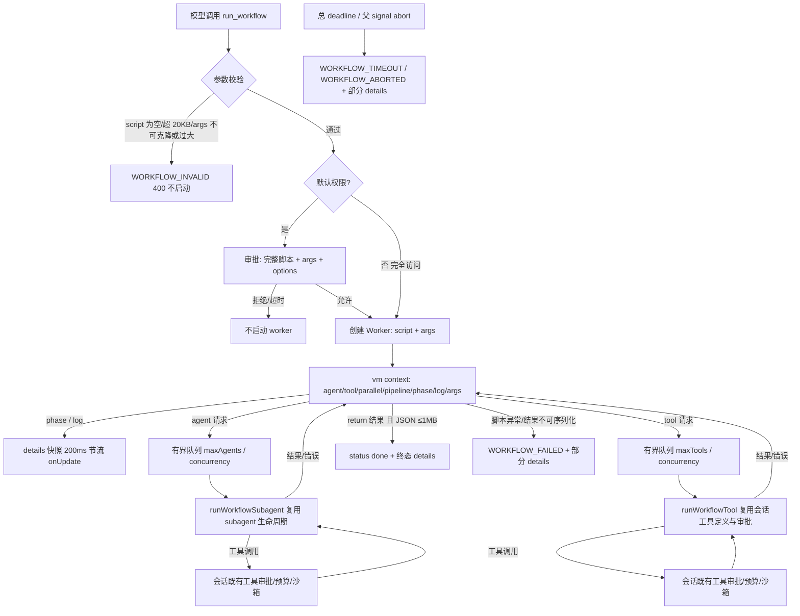

# run_workflow 脚本化多 Agent 与工具编排

> 状态：已实现。本文以 `server/agent-workflow-runner.mjs`、`server/agent-workflow-worker.mjs`、`server/agent-manager.mjs`、`server/agent-subagent-runner.mjs` 及前端消费方源码为准；schema、默认值或错误码变化时先改代码再改本文。

## 1. 背景与目标

`run_subagent` 解决的是**一次有边界的委派**：父 Agent 把一段任务交给一个 Agent Profile，等待它返回结果。但有些工作天然是多个独立委派或分阶段流水线，例如：

- fan-out 调研：同时让多个 `explore` 分别扫描不同目录、模块或测试面；
- 每个文件/模块一个 Agent：按文件清单并行实现或审查；
- 多阶段流水线：先扫描、再分派修复、最后统一验证；
- 需要对每一步产物做结构化校验（JSON Schema）后再继续。

如果让模型手工串行调用 N 次 `run_subagent`，编排逻辑会散落在对话轮次里，难以表达并发、阶段与失败隔离。`run_workflow` 的目标是让模型提交一段**短 JavaScript 编排脚本**，由 QuickForge 在受控环境中执行：

- 脚本只描述“怎么编排”，不直接读写文件、不访问网络、不创建定时器；
- 每个 `agent()` 调用仍复用 `run_subagent` 的完整生命周期（工具集、审批、预算、超时、workspace 归因）；
- `tool()` 让脚本在 Agent 步骤之间直接调用当前会话的工作区工具（读/搜/写/编辑/命令/文件展示/Skill/MCP/Plugin），与主 Agent 使用同一套工具定义、审批与 workspace 沙箱；
- 阶段、Agent 状态、日志与最终结果进入 toolResult `details`，前端工具卡可观察；
- Agent 数量、工具调用数、并发、总时长、脚本大小与结果大小都有硬上限。

### 1.1 run_workflow vs run_subagent

| 维度 | `run_subagent` | `run_workflow` |
|------|----------------|----------------|
| 适用场景 | 单个有边界的任务委派 | 多个独立委派或分阶段流水线 |
| 输入 | `task` / `context` / `expectedOutput`，一次一个 Profile | JavaScript 脚本 + 可选 `args` + 可选 `options` |
| Agent 数量 | 1 | 默认最多 24，硬上限 64（`maxAgents`） |
| 工具调用 | Agent 内部自行调用 | `tool()` 直接调用当前会话工具，默认最多 64，硬上限 128（`maxTools`） |
| 并发 | 不适用（单次调用） | 默认 4，硬上限 8（`concurrency`）；默认权限下实际串行 1（保证审批卡可见） |
| 运行时长 | Profile 默认/上限 2 小时 | 整条工作流默认 1 小时，硬上限 2 小时（`maxRuntimeMs`） |
| 结构化输出 | 无内建 schema 校验 | 每个 `agent()` 可选 JSON Schema，返回校验后的对象 |
| 失败语义 | 失败即该次委派失败 | 单个 agent/tool 失败解析为 `null`，脚本可继续；脚本异常/超时/中止才让工作流失败 |
| 审批 | 每个受保护工具按会话审批策略 | 默认权限下启动脚本前先审批一次；每个 Agent 与 `tool()` 的调用仍按原策略审批 |
| 递归 | 子 Agent 不能再调用 `run_subagent` | 子 Agent 不注入 `run_workflow`，不能递归编排 |
| REST | 无直接 REST 执行入口 | 无直接 REST 执行入口 |

选择建议：

- 只有一个明确、可独立完成的子任务：用 `run_subagent`，更简单；
- 需要 2 个以上独立委派、按文件/模块 fan-out、或存在先后阶段与结构化产物：用 `run_workflow`；
- 脚本里不应该“只包一层 `agent()` 再返回”，这层编排没有收益；直接 `run_subagent` 更清晰。

### 1.2 非目标

- 不是通用 JavaScript 运行时：没有文件系统、网络、定时器、`process`、`require`、`console`。
- 不是 OS 级安全沙箱：worker thread 与 vm context 用于**隔离和可终止**，不是不可信代码的强隔离边界。
- 不是持久化工作流引擎：没有跨会话恢复、断点续跑、定时重试或人工审核节点。
- Subagent 运行详情的 trace 在 Agent 完成/失败时捕获；运行中打开面板只有状态与摘要，步骤结束后补齐；改动前的历史运行没有 trace。
- 不是 REST API：`POST /api/tools/run_workflow` 明确返回 404（见 §8）。

## 2. 架构

### 2.1 模块职责

| 文件 | 职责 |
|------|------|
| `server/tools/definitions.mjs` | `workflowTool` 的元数据与参数 Schema（`script` / `args` / `options`），`executionMode: 'sequential'` |
| `server/agent-manager.mjs` | `wrapWorkflowToolDefinition` 绑定会话并调用 runner；`beforeToolCall` 的审批分支；失败 details 的暂存与 `afterToolCall` 回填 |
| `server/agent-workflow-runner.mjs` | 主进程侧编排：校验、worker 生命周期、总 deadline、父 signal 传播、Agent/工具有界队列、超时/abort、details 构建、JSON Schema 校验 |
| `server/agent-workflow-worker.mjs` | worker 线程入口：vm context + guest bridge（hooks 在 guest 内创建、host 对象不进入脚本）、worker 协议、结果可序列化校验 |
| `server/agent-workflow-tools.mjs` | `tool()` 执行入口：复用 `createServerTools` 的工具定义/包装、按会话策略审批、workspace 归因，并排除递归/控制面工具 |
| `server/agent-subagent-runner.mjs` | `runWorkflowSubagent`：按 Profile 解析并复用 `executeSubagentRun` 的完整 subagent 生命周期 |
| `server/approval-store.mjs` | `run_workflow` 的命令权限限制（`/plan`、`allowSubagents:false`） |
| `server/routes/tools.mjs` | `directRouteDisabledTools` 禁止直接 REST 执行；`GET /api/tools` 仍返回元数据 |
| `src/lib/workflow-run-detail.ts` | 纯视图模型：details → 阶段/Agent/工具/日志/结果 |
| `src/lib/workflow-subagent-detail.ts` | 由 workflow Agent record（含 bounded `subagentRun`）构建 Inspector 复用的 `SubagentRunPayload` |
| `src/lib/tool-renderers/workflow-tool-renderer.tsx` | `run_workflow` 工具卡渲染与 Agent 行「进入 Subagent 运行详情」入口 |

### 2.2 执行链



### 2.3 worker 协议

worker 与主进程只通过 `postMessage` 通信，消息形状如下。

worker → 父进程：

| 消息 | 字段 | 说明 |
|------|------|------|
| `agent` | `requestId`, `prompt`, `options` | 请求执行一步 Agent；`requestId` 单调递增 |
| `tool` | `requestId`, `name`, `args`, `options` | 请求执行一次工作区工具调用 |
| `phase` | `title`, `at` | 开始/切换命名阶段 |
| `log` | `message`, `phase`, `at` | 追加一条进度日志 |
| `done` | `result` | 脚本正常结束并返回结果 |
| `error` | `error` | 脚本语法错误、运行时异常、结果不可序列化/过大 |

父进程 → worker：

| 消息 | 字段 | 说明 |
|------|------|------|
| `agent-result` | `requestId`, `ok`, `hasValue?`, `value?`, `text?`, `content?`, `error?` | 回复 `agent()` / `tool()`；`hasValue:true` 时返回 schema 校验后的对象，否则返回文本；工具返回 `content`；`ok:false` 时脚本侧解析为 `null` |

关键点：

- 脚本以 `(async () => { ... })()` 包装后编译，因此可以 `await` 所有 hooks，并以 `return <JSON-serializable value>` 作为结果契约。
- guest 侧 hooks 全部由 bridge 在 vm 内创建；`args` 以 JSON 字符串进入、在 guest 内解析并深冻结；宿主函数不进入脚本作用域（`__hostCall` 为 null-prototype 且在用户脚本编译前删除），host 回复只以 JSON 字符串经 guest pump 投递。`console` 被显式置为 `undefined`，脚本必须用 `log()` 才能把进度送到工具卡。
- `codeGeneration: { strings: false, wasm: false }` 禁止 `eval`/`new Function`/WASM；测试覆盖 `agent.constructor`、`args.constructor` 等 host/guest 原型逃逸均为 `blocked`。
- 同步执行段有 10 秒 `timeout`；任何阶段卡死仍可由父进程 deadline 与 `worker.terminate()` 兜底。
- worker 设 `resourceLimits`（old generation 256MB / young 64MB），避免脚本或逃逸代码无界分配拖垮服务进程。
- 脚本结果先 `structuredClone` 再 `JSON.stringify`，两者任一失败或 JSON 超过 1MB 都按脚本错误处理。

### 2.4 agent()/tool() 代理与执行生命周期

`agent()` 不创建独立执行器，而是把请求代理回主进程，由 runner 的队列调度：

1. worker 生成 `requestId`，把 `{type:'agent', requestId, prompt, options}` 发给父进程，并挂起 Promise；
2. runner 的 `enqueueAgent()` 规范化请求、登记 agent record、检查 `maxAgents`，然后入队；
3. `drainQueue()` 在 `activeSteps < effectiveConcurrency` 时取出任务，Agent 调用 `runWorkflowSubagent()`、工具调用 `runWorkflowTool()`；`effectiveConcurrency` 在默认权限下固定为 1，完全访问下使用配置的 `concurrency`；
4. `runWorkflowSubagent()` 按 `profile`（默认 `general`）解析已启用 subagent 的 Agent Profile，再调用 `executeSubagentRun()`：创建子 session、解析模型/思考等级、构建工具集、执行 prompt，完整复用 `run_subagent` 的工具审批、预算、超时与错误 details 路径（trace 与部分成果回传关闭）；
5. 结果或错误回到 runner，runner 通过 `agent-result` 回传 worker，`agent()` 解析为文本、校验后的对象或 `null`。

`tool()` 走同一条队列：worker 把 `{type:'tool', requestId, name, args, options}` 发给父进程；runner 的 `enqueueTool()` 登记 Tool record、检查 `maxTools` 与并发，然后调用 `runWorkflowTool()`。后者延迟构建当前会话工具集（`createServerTools`），排除递归/控制面工具，按会话权限发起审批，再执行工具并把文本结果回传；工具失败记录到 `details.tools`，`tool()` 解析为 `null`。

每步的覆盖项：

| 参数 | 作用 |
|------|------|
| `profile` | Agent Profile 名（默认 `general`；`explore` 用于只读调研；也可是已启用的自定义 Profile） |
| `label` | 工具卡与 details 中的展示名；缺省为 `${profile} #<index>` |
| `phase` | 该 Agent 归属的阶段；缺省继承当前 `phase()` |
| `model` | 覆盖该步模型（仍需通过服务端模型引用校验） |
| `maxRuntimeMs` / `maxToolCalls` | 覆盖该步预算（clamp 到 1s–2h / 1–300） |

`runWorkflowSubagent` 使用 `trace: false`、`workReport: false`，因此工作流里的每一步不会像独立 `run_subagent` 那样把完整 trace/部分成果报告写入该工具结果；可观察性由 runner 的 details（阶段/状态/耗时/工具调用数/结果预览/错误）承担。

## 3. Hooks 契约

### 3.1 签名与返回值

| Hook | 签名 | 返回值 | 失败语义 |
|------|------|--------|----------|
| `agent` | `agent(prompt, options?) => Promise<string \| object \| null>` | 默认返回该 Agent 的最终文本；带 `schema` 时返回校验后的 JSON 值；失败返回 `null` | 参数非法（空 prompt、超长、未知 option、schema 不可序列化等）会 throw，通常导致脚本失败；运行失败（含 schema 不匹配、预算耗尽、被中止）返回 `null`，不 throw |
| `tool` | `tool(name, args?, options?) => Promise<string \| null>` | 返回该工具结果的文本内容；失败返回 `null` | 未知/不可用/被排除的工具、参数非对象、`run_command run_in_background`、审批拒绝或工具异常都返回 `null`（错误记录在 details.tools，不中断脚本）；参数/预算耗尽同样返回 `null` |
| `parallel` | `parallel(thunks) => Promise<Array<...>>` | 按输入顺序返回每个 thunk 的结果 | 非函数项直接为 `null`；thunk throw 时为 `null`；不会因单项失败整体 reject |
| `pipeline` | `pipeline(items, ...stages) => Promise<Array<...>>` | 每个 item 独立经过所有 stage，按输入顺序返回最终值 | stage 必须是函数；某个 stage throw 会把该 item 置为 `null` 并跳过它剩余的 stage，其他 item 不受影响；无 stage 时返回 `items.slice()` |
| `phase` | `phase(title) => string` | 规范化后的阶段标题 | 非字符串/空白/超 120 字符 throw |
| `log` | `log(message) => void` | 无 | 非字符串按 `Error.message` / `JSON.stringify` 归一；空文本忽略；单条最多 2000 字符 |
| `args` | `args`（只读值） | 调用方传入的 JSON 值，深冻结 | 无法 `structuredClone` 时在启动前 400 |

`pipeline` 的 stage 签名为 `(previousValue, item, index)`；`parallel` 的 thunk 无参数。两者都是**逻辑并发**，实际同时运行的 Agent/工具步骤数仍由 runner 的 `concurrency` 限制。

### 3.2 agent() options

| 字段 | 类型/边界 | 说明 |
|------|-----------|------|
| `label` | string，≤80 | 展示名 |
| `phase` | string，≤120 | 归属阶段 |
| `profile` | string，≤40 | Agent Profile，默认 `general` |
| `context` | string，≤100,000 | 传给子 Agent 的上下文 |
| `expectedOutput` | string，≤10,000 | 输出要求 |
| `schema` | JSON Schema 对象或布尔，序列化后 ≤20,000 | 校验最终文本；成功时返回对象而非文本 |
| `maxRuntimeMs` | number，clamp 1,000–7,200,000 | 该步超时 |
| `maxToolCalls` | number，clamp 1–300 | 该步工具调用预算 |
| `model` | 模型引用 | 覆盖该步模型 |

未知 option key 会抛 `TypeError`；`schema: null` 等价于不传。`agent` prompt 必须为非空字符串且 ≤100,000 字符。

`tool()` 的 `options` 只接受 `label`（展示名）与 `phase`（阶段）。可用工具是当前会话工具集的子集：排除 `run_subagent`、`run_workflow`、`ask_user`、`todo_write`、`manage_global_memory`、`goal_report`；其余工作区工具、Skill、MCP/Plugin 工具均可调用。`run_command` 的 `run_in_background: true` 在工作流内被拒绝（前台命令可用）。

### 3.3 JSON Schema 校验

当传入 `schema` 时，runner 对 Agent 的最终文本依次尝试：

1. 原文；
2. 围栏代码块（```` ```json ```` 或 ```` ``` ````）；
3. 第一个 `{` 到最后一个 `}` 的子串；
4. 第一个 `[` 到最后一个 `]` 的子串。

找到可解析 JSON 后，用 TypeBox `Value.Check` 校验：

- 成功：`agent()` 返回解析后的对象，record 标记 `schemaValidated: true`，`resultPreview` 存规范化后的 JSON；
- 失败：`agent()` 返回 `null`，record 状态为 `error`，错误文本说明“不是 JSON”或“未匹配 schema（含首个错误路径）”，脚本可自行决定是否继续。

## 4. 限制与预算

| 项 | 默认 | 硬上限/下限 | 超限行为 |
|----|------|-------------|----------|
| `maxAgents` | 24 | 1–64 | clamp 到范围内；达到上限后新的 `agent()` 返回 `null` 并记一条 error 日志，不中断脚本 |
| `maxTools` | 64 | 1–128 | clamp 到范围内；达到上限后新的 `tool()` 返回 `null` 并记一条 error 日志，不中断脚本 |
| `concurrency` | 4（默认权限下实际 1） | 1–8 | clamp；Agent 与工具共用一个步骤队列；默认权限下强制 1 以保证审批卡不互相覆盖（前端只有单个 pending approval 槽位） |
| `maxRuntimeMs` | 1 小时 | 1,000–7,200,000（2 小时） | clamp；到点按超时失败 |
| `script` | — | 20,000 字符 | 启动前 400 `WORKFLOW_INVALID` |
| `args` | — | 20,000 字符 JSON | 启动前 400 `WORKFLOW_INVALID` |
| 工作流结果 | — | 1,000,000 字符 JSON | 脚本错误，工作流失败 |
| 工具结果中的结果正文 | — | 50,000 字符 | 超出截断并追加 `…` |
| 单 Agent 结果预览 | — | 2,000 字符 | `resultTruncated: true` |
| 单 Agent `subagentRun` | — | 约 6,000 字符 JSON | 从最旧消息开始丢，必要时清空 messages/tools；details 总量仍超限时整体丢弃并标记 `subagentRunDropped: true` |
| 单工具参数 | — | 4,000 字符 JSON | 超出改存 `argsPreview` |
| 单工具结果预览 | — | 2,000 字符 | `resultTruncated: true` |
| 工作流结果预览 | — | 20,000 字符 | `resultTruncated: true` |
| 进度日志条数 | — | 200 | 丢弃最旧条目 |
| details 文本总量 | — | 100,000 字符 | 先裁日志/Agent 预览/工具 args，仍超限再丢 `subagentRun` trace，最后压缩结果预览；附 `detailsTruncated: true` |
| 单条错误文本 | — | 2,000 字符 | 截断 |
| 单 Agent prompt | — | 100,000 字符 | `TypeError`，通常脚本失败 |
| 单 Agent `context` | — | 100,000 字符 | `TypeError` |
| 单 Agent `expectedOutput` | — | 10,000 字符 | `TypeError` |
| 同步脚本执行 | — | 10 秒 | vm timeout，脚本错误 |
| 进度节流 | 200ms | — | trailing 合并，终态强制 flush |
| 审批卡脚本 | — | 20,000 字符（完整脚本） | 不再截断；审批展示的就是将执行的代码 |

`options` 必须是普通对象；非对象、`script` 为空/超 20KB、args 无法 `structuredClone` 或 JSON 超 20KB 都会在 worker 启动前以 HTTP 400 / `WORKFLOW_INVALID` 拒绝。数字型 options 非法时回退默认值，超出范围时 clamp，而不是报错。

## 5. 失败、中止、超时与孤儿步骤

### 5.1 错误码

| 场景 | `status` | `errorCode` | details 标志 |
|------|----------|-------------|--------------|
| 启动前参数校验失败 | 未运行 | `WORKFLOW_INVALID`（HTTP 400） | 无 details |
| 脚本语法错误、运行时异常、结果不可序列化/超 1MB | `error` | `WORKFLOW_FAILED` | 部分 phases/agents/logs |
| worker 启动失败、`error` 事件、意外退出 | `error` | `WORKFLOW_FAILED` | 部分 details |
| 超过 `maxRuntimeMs` | `error` | `WORKFLOW_TIMEOUT` | `timedOut: true` |
| 父运行 signal 中止（含启动时已中止） | `aborted` | `WORKFLOW_ABORTED` | `aborted: true` |

失败时 `runWorkflow` reject，Error 上携带 `quickforgeWorkflowDetails`。`wrapWorkflowToolDefinition` 会把它暂存到 `toolCallId`，再由 `afterToolCall` 注入错误 toolResult 的 `details`，因此刷新/恢复后仍能看到失败前的阶段、Agent 与日志。

### 5.2 中止与超时的传播

- runner 内部有一个 `AbortController`；每个 Agent/工具步骤的 signal 是 `AbortSignal.any([controller.signal, parentSignal])`。
- 超时或父中止时：置状态 → `controller.abort()` → 把仍在队列中的 Agent 标为 `aborted`（错误文本 `Workflow stopped before this agent started.`）→ 把仍在运行的 Agent 标为 `aborted`（错误文本 `Workflow stopped while this agent was running.`）→ 清定时器 → 终止 worker → 最后一次 `onUpdate` → reject。
- 正在运行的 Agent 通过组合 signal 收到中止；runner 不等待它们逐个收尾，但终态 details 不会留下 `running` 状态；工具调用返回后也不会再回传 worker。
- 父 signal 在启动前已中止时，直接返回 rejected completion，不创建 worker。

### 5.3 单个 Agent / 工具失败

- `runWorkflowSubagent` 抛错 → runner 捕获 → record 状态为 `error`（若因中止/超时则 `aborted`）→ `agent()` 解析为 `null` → 追加一条 error 日志。
- `runWorkflowTool` 抛错（未知工具、审批拒绝、参数/命令限制、handler 异常）→ record 状态为 `error`/`aborted` → `tool()` 解析为 `null` → 追加一条 error 日志。
- 工作流不会因为某个 Agent 或工具失败而自动失败；最终 `status` 仍可为 `done`，`failedAgentCount` / `failedToolCount` 分别记录失败数，结果文本会列出未成功的步骤。是否把 `null` 视为致命由脚本决定。

### 5.4 孤儿步骤

脚本 `return` 后，未 `await` 的 `agent()` / `tool()` 调用可能仍在运行。`completeWorkflow` 会立即：

1. 中止内部 controller，让在途 Agent 收到 abort；
2. 把队列中和运行中的 Agent 标为 `aborted`（运行中的错误文本为 `Workflow completed before this agent settled.`）；
3. 终止 worker，后续 `agent-result` 不再投递。

因此孤儿步骤不会继续占用会话资源；终态快照不等待它们收尾，但 `details.agents` / `details.tools` 中会显示 `aborted` 而不是永远 `running`。脚本应 `await` 自己需要的所有 Agent/工具。

## 6. 安全模型

- **一次审批，不是永久授权**：默认权限下，`beforeToolCall` 在 worker 启动前对 `run_workflow` 发起一次审批，展示**完整脚本**（≤20KB）、`args` 与 `options`；拒绝或 5 分钟审批超时都不会启动 worker。审批卡的风险说明明确写出“以服务进程权限运行本地 JavaScript”。完全访问模式下跳过这次审批。
- **每个 Agent / 工具的调用仍按原策略审批**：`run_workflow` 的审批只授权“启动编排脚本”，不授权脚本里每个 Agent 的写文件、命令、MCP/Plugin 等操作，也不授权 `tool()` 的写入/命令/MCP 调用；这些操作继续走会话的工具审批（`tool()` 的审批 source 为 `workflow-tool`，UI 显示 Workflow 徽标与对应风险说明）。
- **worker 隔离 ≠ 安全沙箱**：脚本运行在服务器进程内的 worker thread + 独立 vm context 中。guest bridge 不向脚本传递 host 对象（args 以 JSON 字符串进入并在 guest 内解析；host function 为 null-prototype 且在脚本编译前删除；host 回复只以 JSON 字符串回到 guest），测试覆盖常见 `constructor` 原型逃逸；但 worker 仍与服务器同进程，不能当作不可信代码的强隔离。审批提示（默认权限）或完全访问模式才是显式信任边界。
- **脚本自身无直接 IO**：脚本没有 `process`、`require`、`fetch`、`setTimeout`、`console`；文件、网络、命令等副作用只能通过 Agent 或 `tool()` 完成，因此仍受 workspace 沙箱、敏感路径保护与工具审批约束。worker 设 `resourceLimits`，失控分配被限制在 worker 内。
- **结果校验**：每个 Agent 可选 JSON Schema；工作流最终结果必须是可 JSON 序列化且 ≤1MB 的值。
- **不能递归**：Subagent/Profile 会话创建工具时显式 `includeWorkflowTool: false`，`run_workflow` 不会被注入，避免工作流里再嵌套工作流。

## 7. details / UI payload 契约

### 7.1 工作流 details

runner 在运行中与终态发送同一个形状（字段按可用性出现）：

| 字段 | 类型 | 说明 |
|------|------|------|
| `workflow` | `true` | 前端识别工作流 details 的唯一标记 |
| `runId` | string | 优先取 toolCallId，否则 `workflow-<uuid>` |
| `status` | `running` \| `done` \| `error` \| `aborted` | 运行状态 |
| `startedAt` / `durationMs` | number | 起始时间与累计耗时 |
| `maxAgents` / `maxTools` / `concurrency` / `maxRuntimeMs` | number | 本次生效的预算 |
| `agentCount` | number | 已登记的 Agent record 数（达到预算被跳过的调用不登记） |
| `failedAgentCount` | number | `error` + `aborted` 的 Agent 数 |
| `toolCount` | number | 已登记的 tool record 数（达到预算被跳过的调用不登记） |
| `failedToolCount` | number | `error` + `aborted` 的工具调用数 |
| `phases` | `{title, startedAt}[]` | 首次出现顺序；同名阶段只记一次 |
| `agents` | Agent record[] | 见下表 |
| `tools` | Tool record[] | 见下表 |
| `logs` | `{at, phase, message, level}[]` | 最多 200 条；`level` 为 `info` 或 `error` |
| `resultPreview` | string | 工作流结果 JSON，最多 20,000 字符 |
| `resultTruncated` | `true` | 结果预览被截断时出现 |
| `detailsTruncated` | `true` | details 文本总量超过 100,000 字符、日志/预览被裁剪时出现 |
| `error` | string | 失败/中止/超时原因 |
| `timedOut` | `true` | 超时时出现 |
| `aborted` | `true` | 中止时出现 |

Agent record：

| 字段 | 类型 | 说明 |
|------|------|------|
| `id` | string | `agent-<index>` |
| `label` / `profile` / `phase` | string | 展示名、Profile、阶段 |
| `status` | `queued` \| `running` \| `done` \| `error` \| `aborted` | 单步状态 |
| `startedAt` / `durationMs` | number | 起始时间与耗时 |
| `toolCalls` | number | 该步已执行的工具调用数 |
| `schemaValidated` | `true` | 仅 schema 校验通过时出现 |
| `resultPreview` | string | 最终文本或规范化 JSON，最多 2,000 字符 |
| `resultTruncated` | `true` | Agent 结果预览被截断时出现 |
| `error` | string | 失败原因，最多 2,000 字符 |
| `subagentRun` | object | 有界的 subagent trace：`messages`（最多 40 条，文本/工具结果截断）、`tools`（名称/标签）、`allowedTools`、`model`、`thinkingLevel`、`toolCalls`、`pendingToolCalls`、`durationMs`；单 Agent JSON 上限约 6KB |
| `subagentRunDropped` | `true` | details 总量超限、trace 被裁剪时出现；Inspector 仍可用 summary/result 打开 |

Tool record：

| 字段 | 类型 | 说明 |
|------|------|------|
| `id` / `seq` | string / number | `tool-<index>` 与提交顺序；前端按 `seq` 把 Agent 与工具交错展示 |
| `name` / `label` / `phase` | string | 工具名、展示名、阶段 |
| `status` | `queued` \| `running` \| `done` \| `error` \| `aborted` | 单次工具调用状态 |
| `startedAt` / `durationMs` | number | 起始时间与耗时 |
| `args` | object | 参数 JSON ≤4,000 字符时保留，供前端按工具类型生成摘要 |
| `argsPreview` | string | 参数过大时的截断 JSON |
| `resultPreview` | string | 工具文本结果，最多 2,000 字符 |
| `resultTruncated` | `true` | 结果预览被截断时出现 |
| `error` | string | 失败原因，最多 2,000 字符 |

### 7.2 前端视图映射

`src/lib/workflow-run-detail.ts` 的 `buildWorkflowRunView(result, isStreaming)`：

- 仅当 `details.workflow === true` 时返回视图，否则返回 `null`；
- Agent/Tool 状态未知时归一为 `queued`；空日志消息丢弃；
- 阶段顺序：先按 `details.phases`，再补 Agent/工具/日志中出现但 phases 未列出的阶段；
- 运行状态优先级：`aborted` / `status === 'aborted'` → `aborted`（先于 `result.isError`，避免用户停止被显示成失败）；`timedOut` / `details.status === 'error'` / `result.isError` → `error`；`done` → `done`；`running` → `running`；缺失时按 streaming / 是否有 result 推导；
- 汇总字段：`agentCount`、`completedAgentCount`（done）、`failedAgentCount`（error/aborted）、`runningAgentCount`（running/queued）、`toolCount`、`failedToolCount`、`timedOut`、`aborted`、`resultsTruncated`；
- 阶段内按 `seq` 交错 Agent 与工具，保持脚本提交顺序；
- 辅助函数：`workflowStatusLabelKey`、`workflowSummaryKey`、`workflowAgentStatusKey`、`workflowActiveAgentLabels`、`workflowActiveStepLabels`（Agent + 工具）、`workflowCurrentPhase`（最后一个仍有 running 步骤的阶段，否则最后一个阶段）、`formatWorkflowDuration`。

### 7.3 渲染器与 i18n/样式契约

`workflow-tool-renderer.tsx` 注册在 `local-tools.ts` 的 `registerToolRenderer('run_workflow', ...)`：

- 摘要行：状态摘要（`workflowSummaryRunning/Done/Failed/Aborted` + Agent/工具数）+ 跑马灯（运行中优先显示 running/queued 步骤 label，无活跃步骤时显示当前阶段）+ 状态图标/耗时；
- 展开体：错误提示、按阶段分组且按 `seq` 交错的步骤行（Agent 行：状态点、profile、工具调用数、耗时、schema 标记；工具行：工具图标、名称、`summarizeParams` 参数摘要、状态/耗时）、日志、工作流结果预览（截断时附说明）。**每个 Agent/工具行是独立的 `<details>`，默认收起，点击摘要行展开任务/参数与结果**；工作流卡本身也默认收起，形成「外层卡 → 节点行 → 输入/输出」两级可点击结构。工具参数 JSON、工作流脚本与原始 details JSON 只在 `toolDisplayDetailed()`（详细模式）显示，对齐外层工具卡的 input 门控；
- 工具行复用 QuickForge 工具摘要与输出交互：参数摘要单行横向滚动（隐藏滚动条、H5 touch）、结果使用代码块/控制台块（run_command）、状态点与耗时；运行中隐藏状态区并给摘要加 running sweep，`aria-busy` 同步；
- `run_workflow` 与 `run_subagent` 一样**不进入 process-folding 的工具摘要组**，始终保持顶层可点击卡片；否则回合结束后它会被折进收起的「已执行 N 个工具调用」组，用户难以直接展开两级详情。
- **进入 Subagent 运行详情**：Agent 行摘要右侧提供 external-link 入口，展开体内也提供「查看运行详情」按钮；点击（或 Enter/Space）派发既有 `OPEN_SUBAGENT_RUN_EVENT`，由 `src/lib/workflow-subagent-detail.ts` 把 Agent record 的 bounded `subagentRun` 转成 `SubagentRunPayload`，在 Workspace Inspector 打开/激活同一个 Subagent 运行详情 Tab；动作不会切换行内 details。trace 被裁剪时仍以 task/result/summary 打开。
- 无视图时：尚无 result（仍在流式/准备）显示 `workflowPreparing`；已有终态 result 但没有 workflow details（审批被拒、参数校验失败、缺少 workspace/model）显示失败/完成状态与 `resultText` 错误正文，避免把失败永久显示成“正在准备”；
- 有视图时状态映射：`error`/`aborted` 映射为错误态，`running` 映射为运行态，`done` 映射为完成态。

i18n 键（中英成对，位于 `src/lib/i18n.ts`）：`runWorkflow`、`workflowPreparing`、`workflowRunning`、`workflowCompleted`、`workflowFailed`、`workflowAborted`、`workflowSummaryRunning`、`workflowSummaryDone`、`workflowSummaryFailed`、`workflowSummaryAborted`、`workflowAgentCountOne`、`workflowAgentCountMany`、`workflowToolCountOne`、`workflowToolCountMany`、`workflowToolParams`、`workflowToolResult`、`workflowCurrentPhase`、`workflowNoAgents`、`workflowError`、`workflowAgentQueued`、`workflowAgentRunning`、`workflowAgentDone`、`workflowAgentFailed`、`workflowAgentAborted`、`workflowAgentToolCalls`、`workflowAgentSchema`、`workflowResult`、`workflowResultTruncated`、`workflowScript`、`workflowBadge`、`toolApprovalRiskWorkflow`。审批卡按 `run_workflow` 映射 `runWorkflow` 标签；`source.type === 'workflow'` 用本地化徽标与风险说明，workflow 内子 Agent 的审批在 `subagent` 徽标后追加 `workflowBadge`。

样式在 `src/index.css`：`quickforge-workflow-*` 系列 class 负责摘要、阶段、Agent 点/元信息、日志、错误、结果、脚本与空态；Agent 结果区与工作流结果区有最大高度并内部滚动（6rem / 16rem），错误日志使用 `--destructive`，运行点动画在 `prefers-reduced-motion` 下关闭。渲染器 class 链是 CSS/DOM 装饰的契约，改名需同步样式与测试。

## 8. 路由与工具暴露

- `run_workflow` 属于 `workspaceTools`，因此 `GET /api/tools` 会返回其元数据供工具列表消费；工具卡图标与标签仍由本地渲染器和 i18n 固定提供。
- 它没有 `server/tools/index.mjs` handler；执行入口由 `agent-manager.mjs` 的 `wrapWorkflowToolDefinition` 绑定会话。
- `server/routes/tools.mjs` 的 `directRouteDisabledTools` 包含 `run_workflow`，所以 `POST /api/tools/run_workflow`（含项目级变体）返回 404 `Unknown tool`，不能绕过 Agent 会话直接执行。
- 命令/Goal 限制：
  - `/plan` 白名单不包含 `run_workflow`，返回 `Command /plan is read-only and cannot use run_workflow.`；
  - Goal planning 白名单同样不包含，返回 `Goal planning is read-only and cannot use run_workflow.`；
  - 命令显式 `allowSubagents: false` 时返回 `Command /<name> does not allow running workflows.`；
  - 报告 `complete` 后的结算窗口只允许 `read_file`/`grep_files`（验证阻塞时另允许必要 `ask_user`），`run_workflow` 被拒绝；
  - Subagent/Profile 会话通过 `includeWorkflowTool: false` 不注入该工具。

## 9. 测试与验证清单

| 测试 | 覆盖 |
|------|------|
| `tests/server/agent-workflow-runner.test.mjs` | 阶段/日志/命名 Agent、`tool()` 成功/失败/预算与 Agent+工具交错、并发上限与 `parallel` 顺序、默认权限串行、`pipeline` 单项失败隔离、单 Agent/工具失败 → `null`、JSON Schema 成功/失败与 `schema:false`、hooks 白名单、Node globals 缺失、host/guest `constructor` 逃逸阻断、`maxAgents`/`maxTools` 耗尽、脚本语法错误、不可序列化结果、超时/中止后无 `running` 残留、孤儿步骤、details 总量裁剪、`parseStructuredAgentResult` 解析策略 |
| `tests/server/agent-manager.subagents.test.mjs` | 通过真实 `run_workflow` 工具执行脚本，复用真实 subagent 生命周期与真实 workspace 工具集（`tool("read_file")`、`run_in_background` 拒绝），校验内容、details、阶段与运行中更新 |
| `tests/server/approval-store.test.mjs` | `run_workflow` 的 `/plan` 白名单与 `allowSubagents:false` 拒绝语义 |
| `tests/server/agent-approval-orchestrator.test.mjs` | workflow step signal 中止时 pending 审批立即 reject，不等到 5 分钟审批超时 |
| `tests/server/tools/definitions.test.mjs` | `workflowTool` 元数据、参数与 `workspaceTools` 暴露 |
| `tests/frontend/workflow-renderer.test.ts` | 视图模型分组/状态映射/计数、Agent+工具按 seq 交错、工具行渲染、渲染器摘要与展开体、preparing 回退、脚本与 detailed JSON、注册/图标/刷新/审批接线、i18n 成对、CSS 契约 |
| `tests/frontend/approval-card.test.ts` | `run_workflow` 标签、`workflow` / `workflow-tool` 来源徽标与风险说明 |
| `tests/frontend/workflow-step-interaction.test.ts` | 外层卡/步骤行两级展开互不干扰；Agent 行动作派发 `OPEN_SUBAGENT_RUN_EVENT` 且不切换行内 details |

针对性命令：

```bash
npx vitest run tests/server/agent-workflow-runner.test.mjs tests/server/agent-manager.subagents.test.mjs tests/server/agent-approval-orchestrator.test.mjs tests/server/approval-store.test.mjs tests/server/tools/definitions.test.mjs tests/frontend/workflow-renderer.test.ts tests/frontend/workflow-step-interaction.test.ts tests/frontend/process-folding.test.ts tests/frontend/approval-card.test.ts
```

完整验证仍以 `npm run test`、`npm run lint`、`npm run build` 为准；上述单测覆盖契约，但不等于真实模型行为或浏览器视觉/焦点验收。

## 10. 相关文件

- `server/agent-workflow-runner.mjs`
- `server/agent-workflow-worker.mjs`
- `server/agent-workflow-tools.mjs`
- `server/agent-subagent-runner.mjs`
- `server/tools/definitions.mjs`
- `server/agent-manager.mjs`
- `server/approval-store.mjs`
- `server/routes/tools.mjs`
- `src/lib/workflow-run-detail.ts`
- `src/lib/workflow-subagent-detail.ts`
- `src/lib/tool-renderers/workflow-tool-renderer.tsx`
- `src/lib/local-tools.ts`
- `src/lib/i18n.ts`
- `src/index.css`
